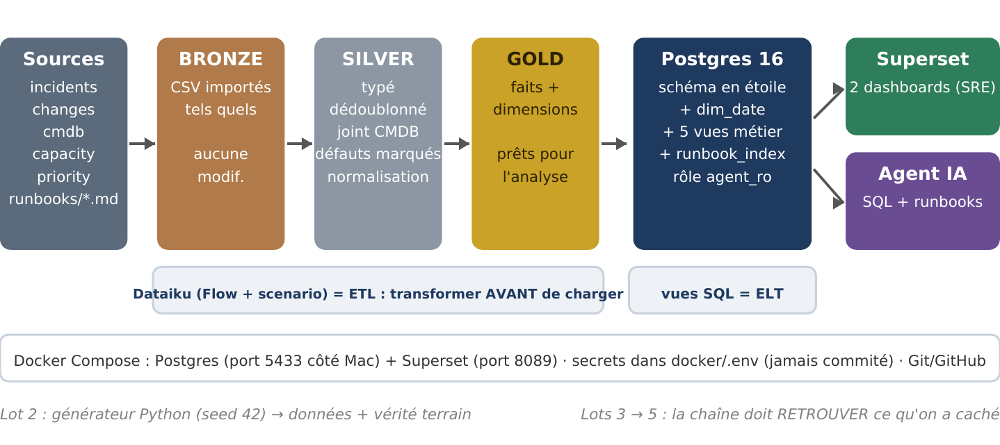

# aps-ops-datalake

**Prototype de datalake de production IT, avec dashboards et agent IA : reconstruction, en miniature, du travail d'une équipe de production applicative (APS) dans une banque.**

Les données d'une équipe de production sont dispersées : les incidents et les changes dans l'outil ITSM, les serveurs dans la CMDB, la capacité dans le monitoring, les procédures dans un wiki. Croiser ces sources à la main dans Excel est si long que l'analyse n'est souvent jamais faite. Ce projet les réunit dans un datalake, les nettoie, les modélise, puis les rend utiles à deux publics :

- les **SRE** (fiabilité), avec deux dashboards Superset ;
- les **opérateurs** (run, astreinte), avec un agent IA qui interroge les données et les runbooks.

Pour **prouver** que la chaîne fonctionne, les données simulées contiennent des **problèmes cachés, connus à l'avance** (vérité terrain) : le projet est réussi s'il les retrouve tous.



---

## Sommaire

1. [Le problème et les utilisateurs](#1-le-problème-et-les-utilisateurs)
2. [Architecture](#2-architecture)
3. [Résultats](#3-résultats)
4. [Lancer le projet](#4-lancer-le-projet)
5. [Structure du dépôt](#5-structure-du-dépôt)
6. [Limites](#6-limites)
7. [Pistes d'amélioration](#7-pistes-damélioration)

---

## 1. Le problème et les utilisateurs

| Persona | Question n° 1 | Décision qui suit | Support |
|---|---|---|---|
| **SRE** (ingénieur fiabilité, revue hebdomadaire) | Quelles applications ou quels CI concentrent les incidents récurrents ou post-change, et lesquels sont critiques ? | Renforcer la revue des changes, ouvrir une analyse de cause racine, automatiser une correction | Dashboards |
| **OPS** (opérateur run / astreinte) | Cet incident est-il déjà arrivé sur ce CI ? Quel runbook s'applique ? Qui prévenir ? | Appliquer le runbook ou escalader vers l'équipe propriétaire | Agent IA |

Six cas d'usage précis en découlent (SRE-1 à 3, OPS-1 à 3). Ils sont détaillés dans [`docs/cadrage.md`](docs/cadrage.md), avec leur définition, la décision associée et les données nécessaires.

## 2. Architecture

| Étage | Outil | Rôle |
|---|---|---|
| **Sources** | Python (`data/generate_data.py`) | 6 mois de données simulées (avril → septembre 2026) : 4 080 incidents bruts, 1 161 changes, 250 CI (40 applications), 41 175 relevés de capacité, 16 runbooks et post-mortems |
| **Bronze** | Dataiku | Import des CSV tels quels |
| **Silver** | Dataiku | Typage, dédoublonnage, jointure à la CMDB, drapeaux qualité `dq_*`, normalisation des descriptions (recette Python : 2 315 → 26 messages distincts) |
| **Gold** | Dataiku → Postgres 16 | Schéma en étoile : 3 tables de faits, 5 dimensions (dont `dim_date` en SQL) |
| **Restitution** | SQL (`sql/views.sql`) | 5 vues métier, chacune répondant à un cas d'usage |
| **BI** | Superset 4.1.1 | Dashboards « Change risk » et « Incident analytics » |
| **IA** | Python + Ollama | Agent à 2 outils : SQL en lecture seule sur la couche gold, recherche sémantique dans les runbooks |

**Choix structurants**

- **Architecture médaillon (bronze → silver → gold).** Chaque couche a une règle : on ne modifie jamais le bronze ; en silver, on corrige quand la vérité est connue, sinon on marque (`dq_*`), et on compte toujours ; en gold, chaque table a un grain explicite.
- **ETL puis ELT.** Dataiku transforme avant de charger (ETL). Les vues SQL transforment dans la base (ELT).
- **Les règles métier sont dans les vues, pas dans les outils.** Superset et l'agent lisent les mêmes vues, donc donnent les mêmes chiffres.
- **On ne stocke jamais un ratio ou une médiane au grain fin.** On stocke des briques 0/1 et on agrège ; une médiane est calculée au grain d'analyse, puisqu'elle n'est pas ré-agrégeable.
- **Sécurité en profondeur.** Superset et l'agent se connectent avec un rôle `agent_ro` en lecture seule (droits `SELECT` seulement, transactions en lecture seule, timeout de 15 s). L'agent ajoute ses propres garde-fous (voir plus bas).
- **LLM local.** Le modèle (`qwen2.5:7b`) et le modèle d'embeddings (`bge-m3`) tournent sur le poste via Ollama : aucune donnée ne sort. Une gateway unique (`agent/llm_client.py`) permet de basculer vers Mistral ou Claude en changeant une variable, et journalise chaque appel, sans le contenu.

**L'agent en bref.** Le modèle ne touche jamais la base : il propose une action en JSON (`query_datalake`, `search_runbooks`, `answer` ou `refuse`), et le code la vérifie puis l'exécute. Garde-fous de l'outil SQL :
1. une seule instruction, `SELECT` uniquement, mots-clés d'écriture interdits ;
2. **liste blanche vérifiée par le moteur** : un `EXPLAIN` (sans exécution) révèle les tables réellement lues, et toute table hors de la couche gold est refusée ;
3. le rôle `agent_ro` côté base ;
4. 50 lignes au maximum renvoyées au modèle, et SQL toujours affiché à l'utilisateur.

Le schéma est lu dans la base au démarrage : il n'est pas recopié à la main dans le prompt.

## 3. Résultats

### Les 5 critères de réussite

| # | Critère | Résultat |
|---|---|---|
| 1 | Les patterns 1, 2 et 4 sont visibles sur les dashboards sans explication | ✅ Voir le tableau ci-dessous |
| 2 | Les checks qualité détectent les défauts injectés, avec leur nombre de lignes | ✅ 5 défauts sur 5, au chiffre près |
| 3 | L'agent répond juste à au moins 10 questions sur 12, et chaque échec est expliqué | ✅ **10/12** après relecture manuelle (11/12 au contrôle automatique) · [analyse](agent/eval/analysis.md) |
| 4 | Le générateur reproduit exactement les mêmes données (seed fixe) | ✅ Empreintes SHA identiques entre deux exécutions ; `check_ground_truth.py` : 9/9 |
| 5 | Une section « Limites » honnête | ✅ [Section 6](#6-limites) |

### La vérité terrain, retrouvée

| Pattern injecté | Où on le retrouve | Résultat |
|---|---|---|
| **1.** 3 applications dont les changes provoquent des incidents | `v_change_risk_by_app` · dashboard Change risk | Customer Portal **72 %** (18/25), Trade Capture **70 %** (23/33), Payments Gateway **55 %** (11/20) ; suivante 29 % ; taux global 17,2 % |
| **2.** Le même incident chaque lundi matin, sur le même CI | `v_recurring_incidents` · dashboard Incident analytics · agent | CI-0121 (Settlement Batch) : **26 semaines sur 26, 100 % le lundi, vers 7 h** ; c'est le seul motif hebdomadaire sur 193 groupes récurrents |
| **3.** Un disque qui se remplit | `fact_capacity` · agent | CI-0048 (General Ledger) à **87,5 %** au dernier relevé ; aucun autre CI au-dessus de 72,2 % sur la période |
| **4.** Une application critique au MTTR anormal | `v_app_criticality` · dashboard Incident analytics | Core Banking : durée médiane P1/P2 = **1,82 × la cible SLA** (n = 65) ; suivante 0,71 |
| **SRE-3.** Catégories fréquentes sans runbook | `v_runbook_coverage` | `cert_expiry` (8ᵉ) et `memory_leak` (9ᵉ) |

| Défaut de qualité injecté | Lignes attendues | Détectées |
|---|---|---|
| Incidents en doublon | 60 | 60 (recette Distinct) |
| Priorité manquante | 80 | 80 (`dq_missing_priority`) |
| `resolved_at` antérieur à `opened_at` | 25 | 25 (`dq_negative_duration`) |
| CI absent de la CMDB | 40 | 40 (`dq_orphan_ci`) |
| `app_id` incohérent avec la CMDB | 50 | 50 (`dq_app_mismatch`) |

### L'agent : 12 questions

Les réponses attendues ont été fixées **avant** l'exécution. Le prompt n'a pas été retouché pour faire passer une question précise. Détail : [`agent/eval/results/latest.md`](agent/eval/results/latest.md) et [`agent/eval/analysis.md`](agent/eval/analysis.md).

- **Réussites** : SRE-1, SRE-3, OPS-1, OPS-2 (incident hebdomadaire et RB-005), OPS-3, qualité des données, 2 refus (demande d'écriture, question hors périmètre).
- **Échec Q03** : le modèle a filtré sur `breach_rate > 1`, une condition impossible pour un taux compris entre 0 et 1, puis a conclu « aucune application » à partir d'un résultat vide. Cause : le schéma transmis au modèle ne donne pas le sens des colonnes.
- **Échec Q10**, requalifié à la relecture : l'agent dit justement qu'aucun runbook ne couvre l'expiration d'un certificat, puis recommande un runbook LDAP hors sujet, avec une justification inventée.

Les dashboards, en captures : [Change risk](superset/change_risk.png) · [Incident analytics](superset/incident_analytics.png) · [Flow Dataiku](dataiku/flow.png)

## 4. Lancer le projet

**Prérequis** : Docker Desktop, Python 3.11 ou plus, Dataiku DSS (Free Edition), Ollama. Testé sur Mac Apple silicon (M4, 16 Go).

```bash
# 1. Environnement Python et données
python -m venv .venv && source .venv/bin/activate
pip install -r requirements.txt
python data/generate_data.py && python data/check_ground_truth.py     # attendu : 9/9

# 2. Postgres et Superset (copier puis remplir les secrets)
cp docker/.env.example docker/.env
docker compose -f docker/compose.yml up -d --build
docker exec -it aps-superset superset db upgrade
docker exec -it aps-superset superset fab create-admin --username admin --firstname A --lastname B --email admin@example.com
docker exec -it aps-superset superset init                            # puis http://localhost:8089

# 3. Dataiku : importer les CSV de data/ et reconstruire le Flow (voir dataiku/flow.png),
#    en écrivant la couche gold dans Postgres (localhost:5433, base datalake)

# 4. Couche SQL
docker exec -i aps-datalake-db psql -U aps -d datalake < sql/schema.sql
python data/build_runbook_index.py | docker exec -i aps-datalake-db psql -U aps -d datalake
docker exec -i aps-datalake-db psql -U aps -d datalake < sql/views.sql
set -a; source docker/.env; set +a
docker exec -i aps-datalake-db psql -U aps -d datalake -v agent_pwd="$AGENT_DB_PASSWORD" < sql/roles.sql

# 5. Superset : importer l'export des dashboards (superset/), connexion datalake-db:5432 avec agent_ro

# 6. Agent
ollama pull qwen2.5:7b && ollama pull bge-m3
cp agent/.env.example agent/.env
python agent/rag.py --build
python agent/agent.py "Quel incident revient chaque semaine, sur quel CI et à quel moment ?"
python agent/eval/run_eval.py
```

## 5. Structure du dépôt

```
aps-ops-datalake/
├── data/        générateur, contrôle de la vérité terrain, index des runbooks, runbooks/
├── dataiku/     captures du Flow et du scenario
├── docker/      compose.yml (Postgres + Superset), .env.example
├── sql/         schema.sql (dim_date), views.sql (5 vues), roles.sql (agent_ro)
├── superset/    Dockerfile (pilote Postgres), export et captures des dashboards
├── agent/       llm_client.py (gateway), tools.py (SQL), rag.py (runbooks), agent.py, eval/
└── docs/        cadrage, guide des dashboards, code expliqué, architecture
```

## 6. Limites

**Sur les données et la méthode**
- **Données synthétiques.** La chaîne retrouve ce qu'on y a caché. Cela ne prouve pas qu'elle trouverait des patterns inconnus dans des données réelles, plus bruitées. La vérité terrain a aussi un côté circulaire : les mêmes hypothèses ont servi à générer les données et à concevoir les vues.
- **Corrélation ≠ causalité.** Un incident ouvert dans les 48 h après un change, sur le même CI, désigne un **candidat**, pas un coupable : 8 incidents sur 223 tombent même dans la fenêtre de deux changes à la fois. En production, on utiliserait le lien explicite ticket ↔ change de l'outil ITSM.
- **Fenêtre de 48 h arbitraire.** Le résultat dépend de ce choix ; il n'a pas fait l'objet d'une analyse de sensibilité.
- **Cibles SLA supposées** (4 h, 8 h, 2 j, 5 j), et non issues d'un référentiel réel.
- **Doublons exacts seulement.** Faute de colonne `updated_at`, on ne gère pas les mises à jour d'un même ticket. Pas de graphe de dépendances entre CI : l'impact « en aval » d'une panne n'est pas couvert.
- **Descriptions générées** avec un même nombre aléatoire par message, ce qui produit parfois une alerte irréaliste (« disque à 29 % »).

**Sur la restitution**
- Les **médianes** (MTTR, ratio au SLA) sont calculées sur toute la période, dans les vues : un filtre de période dans Superset ne s'y applique pas.
- Les **filtres natifs** de Superset (période, application, équipe) n'ont pas été mis en place. Les graphiques lisent des vues de grains différents, et le gain a été jugé marginal face au temps disponible.
- **Semaines incomplètes** en début et fin de période (le 1ᵉʳ avril et le 30 septembre tombent un mercredi) : les barres plus basses ne signalent pas une baisse d'activité.

**Sur l'agent**
- **Évaluation sur 12 questions seulement** : 10/12 = 83 %, avec un intervalle de confiance à 95 % d'environ 55 % à 95 %. Trois questions ressemblent à celles utilisées pendant la mise au point, donc leur score est probablement optimiste.
- **Modèle local de 7 milliards de paramètres** : il confond des colonnes au nom proche et prend parfois un résultat vide pour une réponse (Q03).
- **Recherche sémantique** : les scores de similarité d'un bon et d'un mauvais runbook se chevauchent (0,56 dans les deux cas). Un seuil ne suffit pas, et la vérification par le modèle reste imparfaite (Q10).
- Contrôle automatique par expressions régulières : il mesure la présence de mots, pas la justesse du conseil. D'où la relecture manuelle.

**Sur l'industrialisation**
- **Dataiku Free Edition** : pas de trigger planifié. Le scenario `rebuild_gold` est lancé à la main ; en production, un trigger quotidien ou un ordonnanceur d'entreprise le déclencherait.
- Le Flow Dataiku est documenté par des captures, pas par un export rejouable.
- Prototype local : ni haute disponibilité, ni supervision, ni tests automatisés en CI.

## 7. Pistes d'amélioration

1. **Dictionnaire de données dans la base** (`COMMENT ON COLUMN`), injecté dans le prompt de l'agent : corrige directement la cause de l'échec Q03, et sert aussi Superset et les humains.
2. **Recherche hybride** (mots-clés + sens) avec filtre sur la catégorie de l'incident, puis `pgvector` pour stocker les embeddings dans Postgres.
3. **Évaluation plus large** (une centaine de questions, plusieurs exécutions) et comparaison de modèles via la gateway (Qwen local, Mistral, Claude).
4. **Analyse de sensibilité** de la fenêtre change → incident (24 h, 48 h, 72 h).
5. Orchestration planifiée, tests de qualité automatisés, et lien explicite ticket ↔ change.

---

*Projet personnel réalisé en octobre 2026, en préparation d'un entretien pour un stage d'ingénieur Data/IA en production IT. Conception, cadrage, choix de modélisation, tests et débogage : Paul-Alex Yao. Une partie du code a été écrite avec l'aide d'un assistant IA, puis relue, testée et corrigée.*
